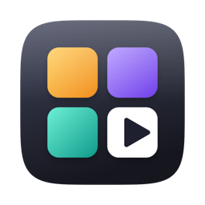
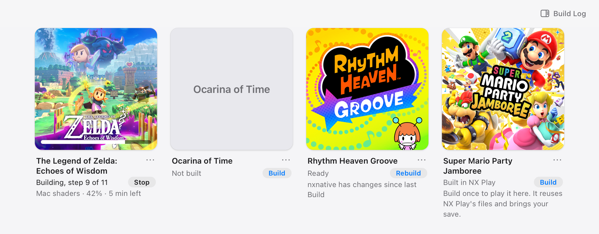
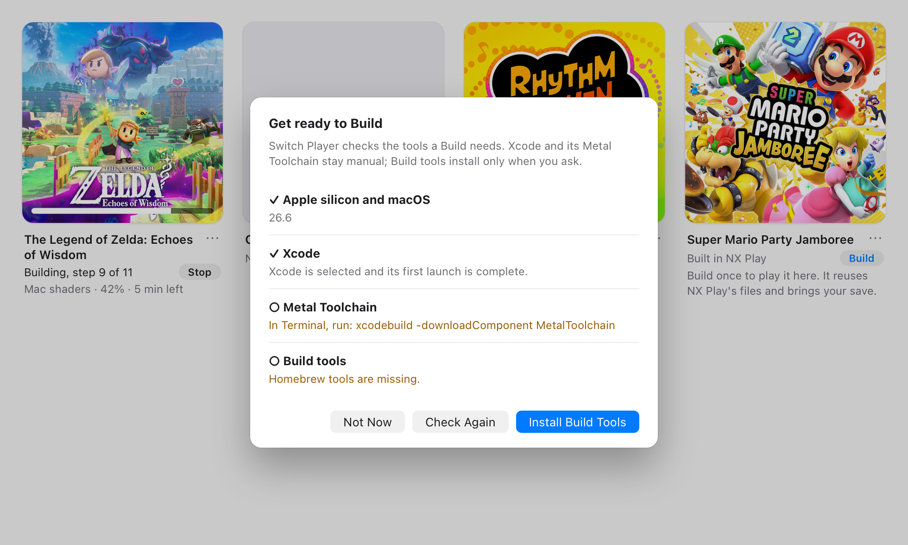
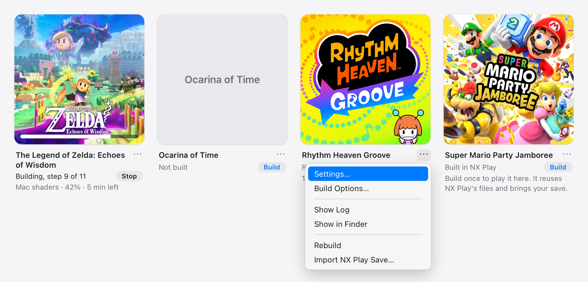

#  Switch Player

A Mac app that builds and plays your own Switch games through [nxnative](https://github.com/seedds/nxnative), without the command line.

**[Download the latest release](https://github.com/DigitalN/SwitchPlayer/releases/latest)** · Apple silicon · macOS 26.6 or later

## What it does

- Shows your Library as a grid, with each game's own name and eShop artwork.
- Builds a Mac Game app for each game with nxnative, one Build at a time, with progress, logs and Stop.
- Plays a built game straight from its artwork, or opens its own Settings window.
- Tells you when nxnative has changes for a game you've built, and which ones are worth a rebuild.
- Picks up where NX Play left off: its Library folder, keys file, builds and saves.

Switch Player doesn't include any games or keys.

## Requirements

- An Apple silicon Mac with macOS 26.6 or later.
- For Builds: Xcode, opened once, with its Metal Toolchain, the .NET SDK, and [Homebrew](https://brew.sh). Build Setup checks for these and installs the Homebrew tools when you ask.
- Several gigabytes of disk space per game for its build folder.

## Getting started

1. Open the disk image and drag **Switch Player** to **Applications**.
2. Open Switch Player. Coming from NX Play? Your Library folder and keys file are picked up automatically. Otherwise choose **Switch Player → Choose Library Folder…**, with one folder (or one `.nup` file) per game, and **Choose Keys File…** if your games need keys.
3. **Build Setup** opens each time Switch Player starts and lists what a Build needs. Follow its Xcode and Metal Toolchain steps, and run the one Terminal command it shows for the .NET SDK (it asks for your password, which an app can't), then click **Install Build Tools**. Once everything has a tick, click **Done**.
4. Click **Build** beside a game. The first Build also downloads nxnative and installs the Python packages it needs, so it takes a little longer.
5. When the game says **Ready**, click its artwork to play.

Closing the window doesn't stop a Build. Quitting Switch Player asks first.

## Coming from NX Play

Games NX Play built show **Built in NX Play**. NX Play builds with nxnative's developer mode, which doesn't make a Mac app to open, so Build each game once in Switch Player. That Build reuses the files NX Play already extracted and its shader cache, and brings your NX Play save across.

To bring a save across again later, choose **Import NX Play Save…** from the game's **⋯** menu. Switch Player shows both saves' dates, asks first, and backs up the current save before replacing it.

## Each game's menu

Click **⋯** or right-click a game for its **Settings…** window, **Build Options…**, **Show Log**, **Show in Finder**, **Rebuild** and **Import NX Play Save…**.

## Staying up to date

**nxnative** changes often. Switch Player compares your built games with the latest nxnative each time it opens and once a day. When a change affects a game, its tile says *Your version is out of date, consider rebuilding*; other changes show as a count. **Switch Player → Check for nxnative Updates…** checks now and tells you what it found. Every Build uses the latest nxnative.

**Switch Player** updates itself from this repository's releases, checking once a day. **Switch Player → Check for Updates…** checks now.

### Building with your own nxnative checkout

By default Switch Player keeps its own copy of nxnative and moves it to the latest code at each Build. To build with a checkout of your own instead, for example to try local changes, set `nxnative_checkout` in its settings file; see [Another nxnative checkout](docs/DEVELOPMENT.md#another-nxnative-checkout).

## Development

See [the design](docs/DESIGN.md), [development and release instructions](docs/DEVELOPMENT.md), and [project terminology](GLOSSARY.md).
